<p align="center">
  
</p>

# V-On Patcher

Gets *Cyber Troopers Virtual-On* (PC, 1997) running properly on a modern
system. It installs the game from a disc image and fixes the crashes, the
frame rate and the keyboard. Then the extras: 1920x1080 rendering, XInput
gamepads for both players, the soundtrack from files instead of the disc,
two-player versus over the internet with a code to share and no port
forwarding, and the two bosses, Jaguarandi and Z-Gradt, as machines you
can earn and play.

<p align="center">
  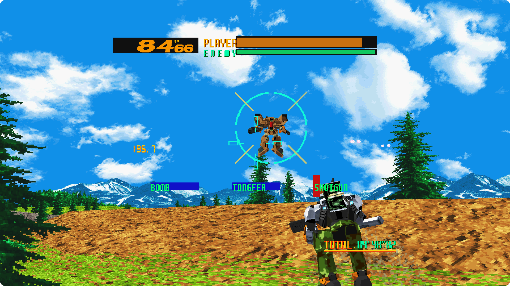
  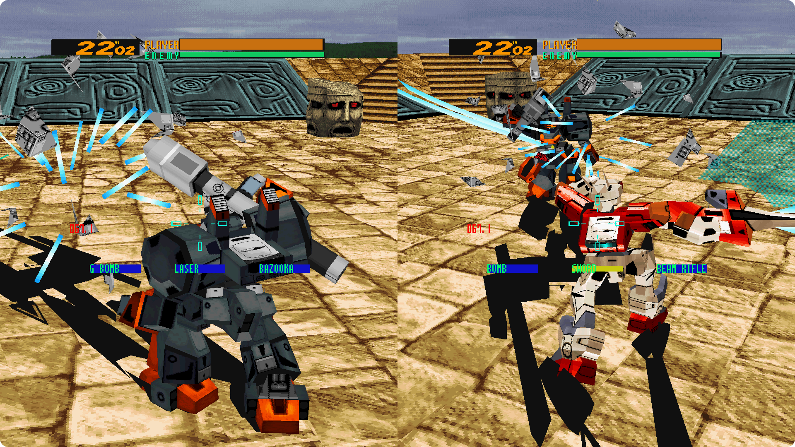
</p>

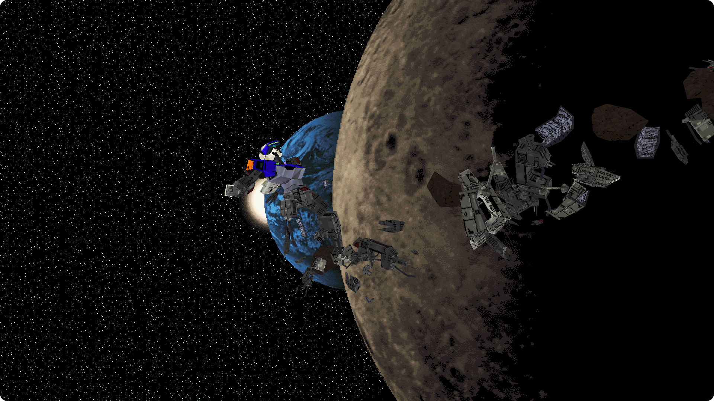

<p align="center">
  ...in a nutshell - the patch makes the game <i>just work ™️</i>
</p>

<p align="center">
  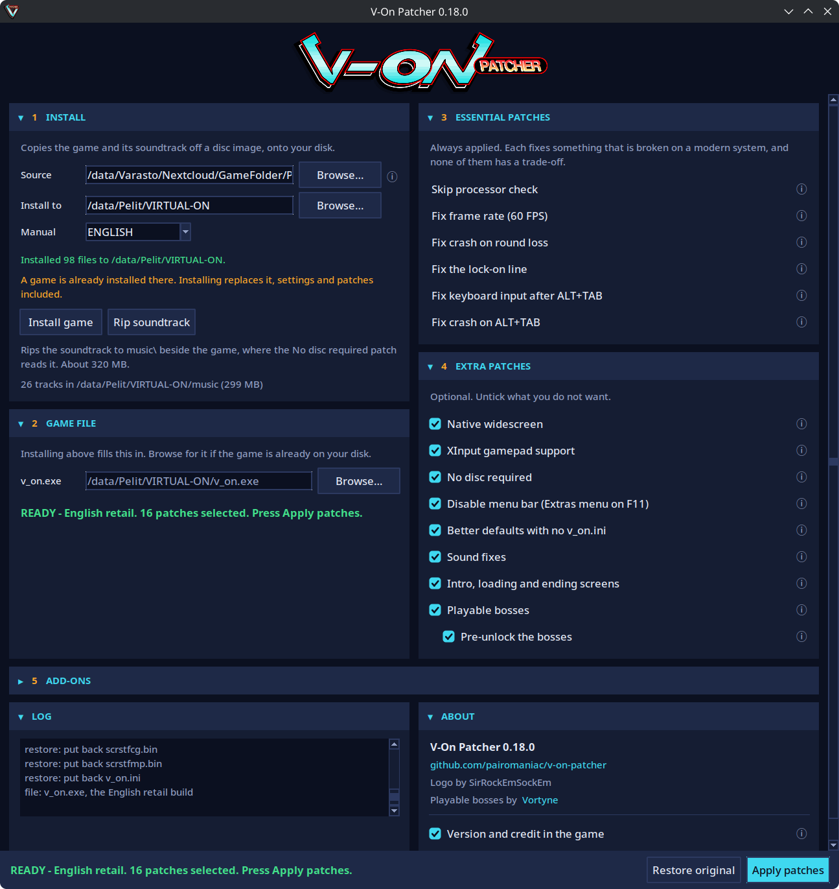
</p>

<h4 align="center">
  <a href="#quick-start">Quick start</a> &nbsp;·&nbsp;
  <a href="#virus-warnings">Virus warnings</a> &nbsp;·&nbsp;
  <a href="#what-the-patches-do">Patches</a> &nbsp;·&nbsp;
  <a href="#native-widescreen">Widescreen</a> &nbsp;·&nbsp;
  <a href="#playable-bosses">Bosses</a> &nbsp;·&nbsp;
  <a href="#gamepad">Gamepad</a>
  <br /><br />
  <a href="#internet-play">Internet play</a> &nbsp;·&nbsp;
  <a href="#music">Music</a> &nbsp;·&nbsp;
  <a href="#windowing-and-scaling-cnc-ddraw">Windowing</a> &nbsp;·&nbsp;
  <a href="#builds">Builds</a> &nbsp;·&nbsp;
  <a href="#running-the-python-script">Python script</a>
</h4>

## Quick start

**Download** `v-on-patcher-*-win.zip` from the
[latest release](https://github.com/pairomaniac/v-on-patcher/releases/latest),
unzip it anywhere and run `v-on-patcher.exe`. The `_internal` folder beside
it has to stay. If SmartScreen or a virus scanner objects, see
[Virus warnings](#virus-warnings). On Linux, see
[Running the Python script](#running-the-python-script).

The window is split into numbered sections. Work through them in order:

1. **INSTALL** - put your `.cue` sheet in **Source**, choose a folder in
   **Install to**, and press **Install game**. Then press **Rip soundtrack**,
   unless you plan to keep a disc in the drive. If the game is already
   installed, start at 2; the tracks are ripped beside whichever `v_on.exe`
   you pick there. See [Installing from a disc image](#installing-from-a-disc-image)
   and [Music](#music).
2. **GAME FILE** - installing fills this in. Otherwise browse to your
   `v_on.exe`. Only an unmodified disc copy is accepted; if yours is
   refused, see [Builds](#builds).
3. **ESSENTIAL PATCHES** - always applied, no tick boxes.
4. **EXTRA PATCHES** - most are ticked to start with, and all are yours to
   change. Click the ⓘ beside a patch to read what it does. Then press
   **Apply patches**.
5. **ADD-ONS** - starts collapsed. Press **Install** on the rows you want:
   **Internet play** for two-player versus over the internet (both players
   need it), and **Windowing and scaling** for windowed and borderless play
   through cnc-ddraw.

Then play. **Restore original** puts the game back if you change your mind.
Add-ons put files beside the game rather than editing it, so Apply and
Restore leave them alone.

## Virus warnings

The exe is signed with a Certum open-source code signing certificate
(Properties → Digital Signatures). SmartScreen can still warn until it
has built up a reputation: **More info** → **Run anyway**.

Scanners can still flag it, since a program that edits another program
is what they look for. A detection ending in `!ml`, such as Defender's
`Trojan:Win32/Wacatac.B!ml`, is a machine-learning guess, not a match
for anything known. To allow it in Defender: Windows Security → Virus &
threat protection → Protection history → the entry → **Allow**.

Every release is built on GitHub from this repository. If you would
rather not run the exe, `v-on-patcher.py` does everything it does; see
[Running the Python script](#running-the-python-script).

## Installing from a disc image

The patcher reads the image itself, so there is nothing to mount and no
virtual drive to set up.

<p align="center">
  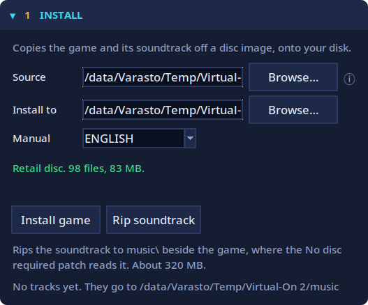
</p>

Put the **`.cue`** sheet in **Source**: the small file beside the `.bin`
files, not the `.bin` itself. Choose a folder in **Install to** and press
**Install game**. The game is about 95 MB.

The **Manual** box picks which `readme.txt`, `von.hlp` and `von.cnt` are
copied. It does not change the language of the game, which is the same in
every pressing. `von.hlp` is 1997 WinHelp, which Windows has not opened
since Windows 10; the readme is plain text.

Or from a terminal:

```bash
python3 v-on-patcher.py --install VIRTUAL-ON.cue ~/games/VIRTUAL-ON
python3 v-on-patcher.py --install VIRTUAL-ON.cue ~/games/VIRTUAL-ON --language GERMAN
```

### If you have the disc, not an image

The patcher needs a `bin`/`cue` pair. It does not read a drive directly, and
a plain ISO will not do because it drops the audio tracks. Image the disc
once:

- **Windows** - [ImgBurn](https://www.imgburn.com) in *Read* mode, with the
  output set to **BIN/CUE** rather than ISO.
- **Linux** - `cdrdao`, then its own `toc2cue`:

  ```bash
  cdrdao read-cd --driver generic-mmc-raw --datafile VIRTUAL-ON.bin \
      VIRTUAL-ON.toc /dev/sr0
  toc2cue VIRTUAL-ON.toc VIRTUAL-ON.cue
  ```

Then put the `.cue` in **Source**. On Linux a drive can also go straight in
**Source** for the soundtrack rip, though not for the install; see
[Music](#music).

### What it copies

The game directory and the chosen manual, nothing else. No `v_on.ini` is
written: the game makes its own on first run, and with **Better defaults**
applied it is a good one. How the copy rules are read off the disc is in
[NOTES.md](docs/NOTES.md#installing-from-a-disc-image).

## What the patches do

<p align="center">
  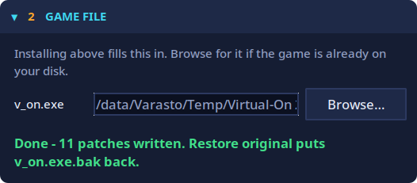
</p>

**Essential** fixes what is broken on modern systems and is always applied.
Without it the game does not start, crashes when you lose a round, runs at a
third of the frame rate, or loses the keyboard after ALT+TAB.

**Extra** is down to taste. Untick what you do not want. How every patch
works inside the game is in [NOTES.md](docs/NOTES.md).

### Essential

- **Skip processor check** - the game refuses to start on a modern CPU.
  Removes the check, so `ProcessorCheck=Off` in `v_on.ini` is not needed.
- **Fix frame rate (60 FPS)** - the game ran at about 70% speed on
  Windows 2000 and later, and ignored the `Motion=` line in `v_on.ini`.
  Both are fixed, and the *Motion Type* radios on F5, which only ever
  offered 1/3 and 1/2 speed, now read **30 FPS** and **60 FPS**.
- **Fix crash on round loss** - the game crashes when you lose as Temjin,
  Viper II, Apharmd or Raiden.
- **Fix the lock-on line** - the line from the enemy to the distance
  readout flashed across the screen as a grey band whenever the enemy was
  far off to one side.
- **Fix keyboard input after ALT+TAB** - alt-tabbing away, or opening an
  F-key dialog, killed the keyboard for the rest of the session. Keys
  pressed in another window now still reach the game while it is running.
- **Fix crash on ALT+TAB** - switching away during the intro movie crashed
  the game on the way back.

### Extra

- **Native widescreen** - the game renders at 1920x1080 instead of 640x480,
  with menus and text redrawn to match and more of the arena at the sides.
  See [Native widescreen](#native-widescreen).
- **XInput gamepad support** - a modern controller for both players: twelve
  bindable actions, plus the arcade twin-stick scheme. See
  [Gamepad](#gamepad).
- **No disc required** - removes the disc check and plays the soundtrack from
  `music\trackNN.wav` beside the game. See [Music](#music).
- **Disable menu bar (Extras menu on F11)** - hides the menu bar. The
  Debug options move to a new F11 dialog: No shot, SE, CD, Kill 1P, Kill 2P,
  Scorekeeping and Quit Game. **Credits** is new: it jumps to the credit
  roll from any match. With the gamepad patch on, F11 also sets each
  player's [stick deadzone](#stick-deadzone). Like the other F keys, it
  does nothing during an internet match. Every other menu was already on a
  key:

    | Key | Opens |
    | --- | --- |
    | **F1** | Help |
    | **F3** | Pause |
    | **F4** | High / low resolution (1080p / 720p with Native widescreen on) |
    | **F5** | Graphic Settings |
    | **F6** | Mode Settings |
    | **F7** | Device Settings |
    | **F8** | Sound Test |
    | **F11** | Extras, the new dialog |

- **Better defaults with no v_on.ini** - what the game falls back on for any
  setting `v_on.ini` does not have, which on a first run is all of them: Sky
  on, all three Texture boxes on, Field Graphic Rich, Screen Large.
- **Sound fixes** - removes the built-in delay before each sound effect,
  raises the output from 22050 to 44100 Hz, and gives an enemy Fei-Yen back
  the hypermode sound a bug left silent.
- **Intro, loading and ending screens** - the intro movie fills the window
  instead of sitting in a corner, with the black bars inside its frames
  cropped off. "Now Loading . . ." is hidden. The ending credits can be
  skipped by holding **A**, **Select** or Space for a second; stock has no
  way past them. The initials screen after them takes those buttons and
  either weapon trigger too, so 2P skips with **RT**.
- **Playable bosses** - Jaguarandi and Z-Gradt as machines you can pick in
  a one-player game, once earned. Unticked by default. See
  [Playable bosses](#playable-bosses).
- **Pre-unlock the bosses** - both bosses selectable from the start, without
  the earning. Needs Playable bosses. Unticked by default.

### About

**Version and credit in the game** is on by default. It prints the patcher's
version in the bottom right of the title screen and adds two lines under the
title of the ending credits. If either of the two files it rewrites is
missing, the whole box is skipped and everything else still applies.

### Add-ons

Open the collapsed **ADD-ONS** header and press **Install** on a row. The
same button reads **Remove** once installed.

<p align="center">
  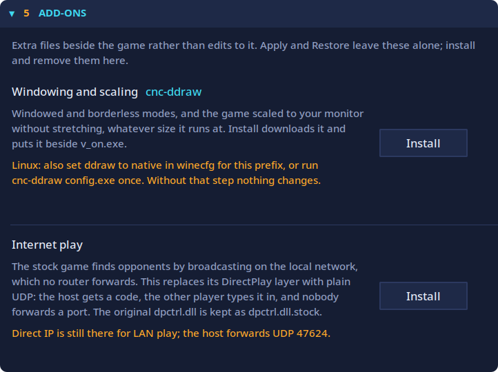
</p>

| Row | What it is |
| --- | --- |
| **Internet play** | two-player versus over the internet. Both players need it. See [Internet play](#internet-play) |
| **Windowing and scaling** | downloads and installs cnc-ddraw beside the game. See [Windowing and scaling](#windowing-and-scaling-cnc-ddraw) |

## Native widescreen

The game draws everything at 640x480 and assumes that size everywhere, so
scaling the picture up only makes it bigger. This patch makes the game
render at 1920x1080 itself. The 3D view, the menus, the HUD and the text are
all drawn at that size, and the wider view shows more of the arena at the
sides rather than stretching the middle.

<p align="center">
  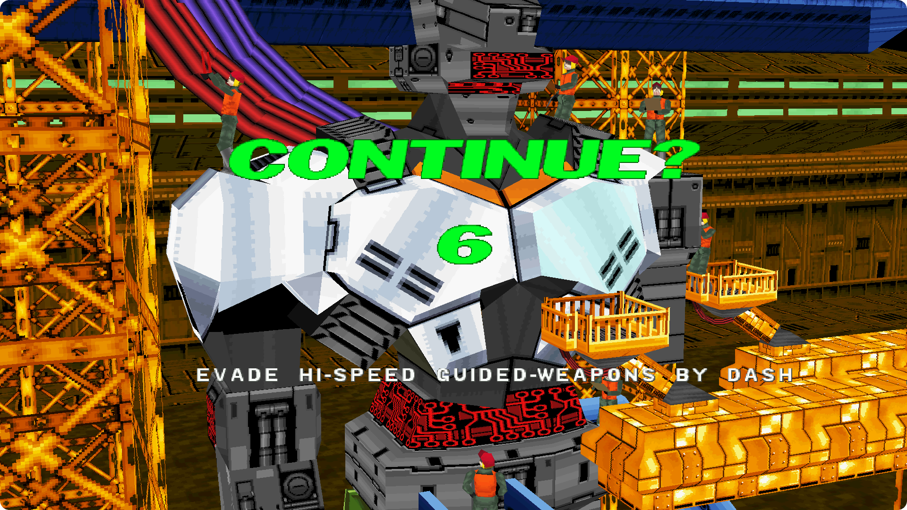
  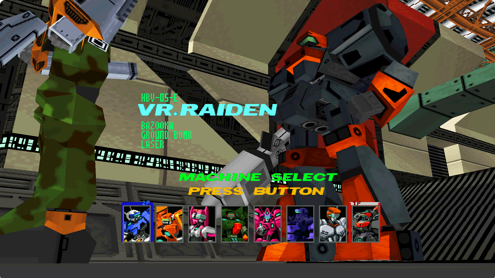
  <br />
  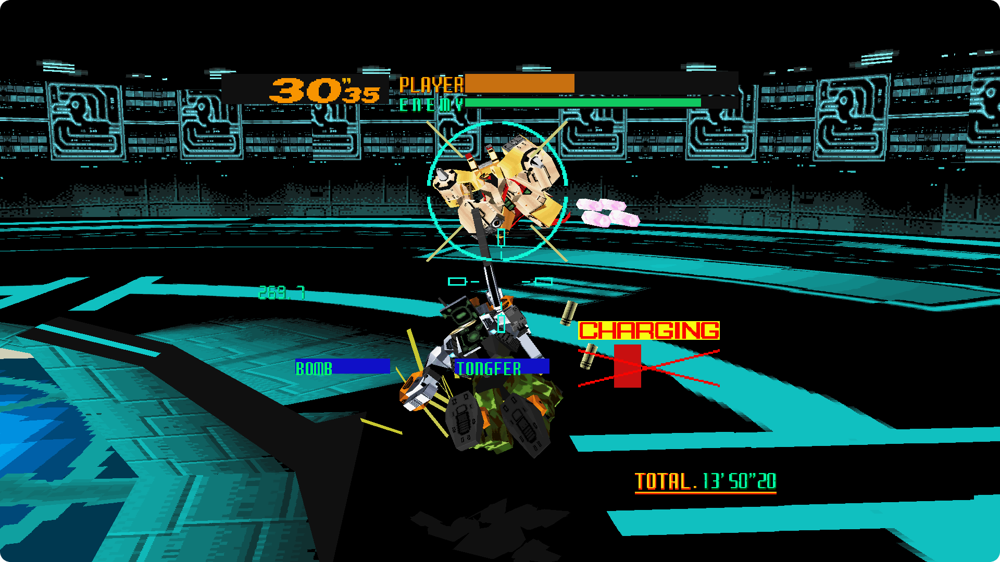
  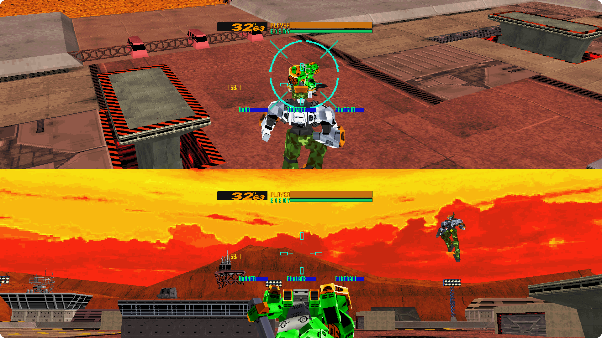
  <br />
  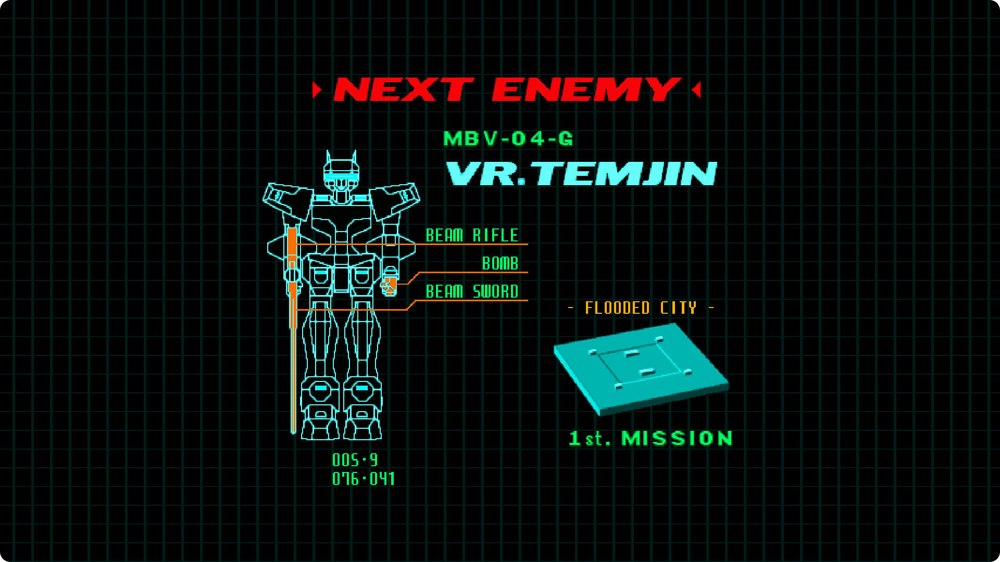
  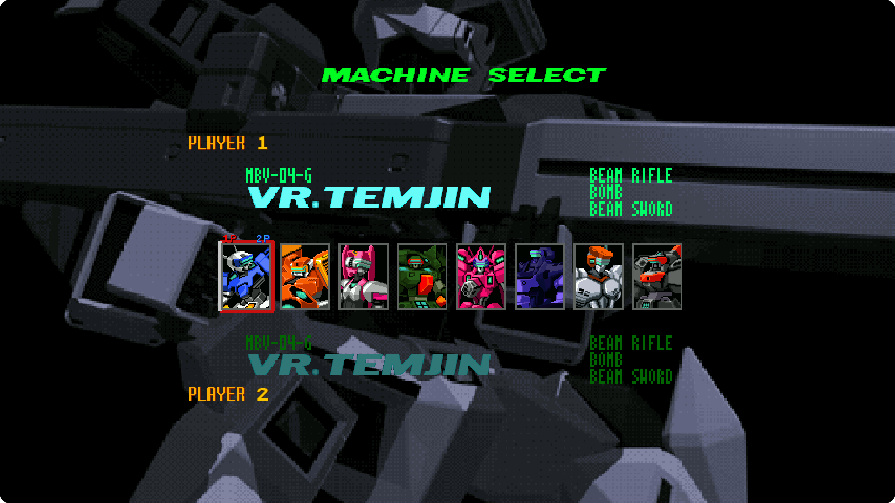
</p>

It is **on by default**. Untick it for the original 640x480.

### What changes

- **Resolution** - **F4** switches between 1920x1080 and 1280x720, in place
  of the stock 640x480 / 320x240, and the **Screen** row on F5 offers the
  same choice as **1080p** / **720p**. The choice is saved to `v_on.ini`, so
  the game starts at the size it was left in.
- **HUD** - in a match the timer stays at the top left and the health bars
  are centred. The photo backdrops of the two-player machine select and
  waiting screens fill the screen instead of sitting in a black frame.
- **Split screen** - the **Screen Split** row on F5 offers **Ver** (side by
  side) and **Hor** (top and bottom). In side-by-side mode the timer and
  health bars sit at the top of each half. The machine select is drawn
  once at full size instead of the same grid in both halves.
- **Text** - the pause, loading and credits text scales with the picture.
  The ending credits lose their black bands and roll across the whole
  screen.

### Works with everything else

It works with every other patch and with cnc-ddraw, which is what gives you
windowed or borderless play at that size; see
[Windowing and scaling](#windowing-and-scaling-cnc-ddraw). It applies to all
four [builds](#builds). On the USA OEM and Japanese builds it has had less
play; if something looks wrong there, say which build in the report. The
window names it.

## Playable bosses

Jaguarandi and Z-Gradt are the game's two bosses. This patch lets you play
as them in a one-player game. The game already knows how to run them as
fighters; what it never had was a way to pick them. The patch adds them to
the machine select, fits the camera and the hangar to their size, and
fixes every screen the game drew for the eight only.

<p align="center">
  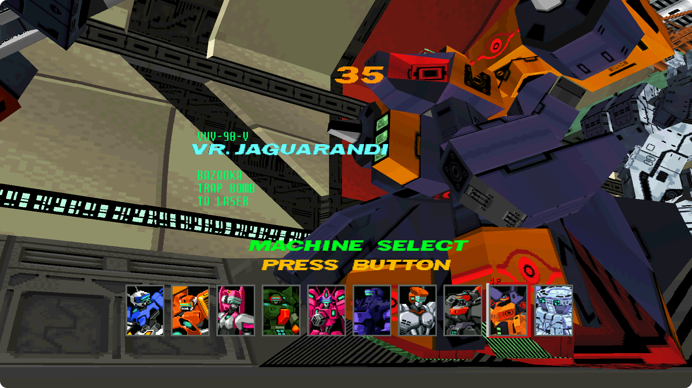
  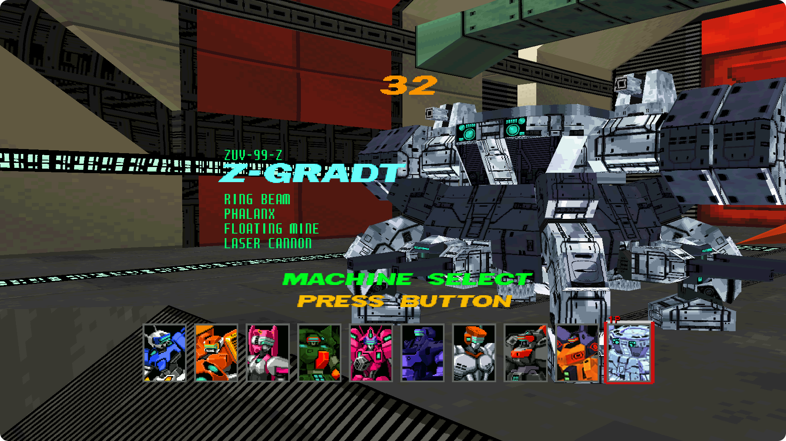
</p>

It is **unticked by default**, because it changes the game rather than
fixes it. **Pre-unlock the bosses** beside it skips the earning.

### Unlocking

- **Jaguarandi** - beat it on Very Hard without losing a match earlier in
  the run.
- **Z-Gradt** - once Jaguarandi is unlocked, finish the game on Very Hard
  without losing a match.

A continue counts as a lost match. Each unlock gets a screen of its own.
Both are saved in `bosses.bin` next to the game, which survives restarts,
re-patching and **Restore original**.

<p align="center">
  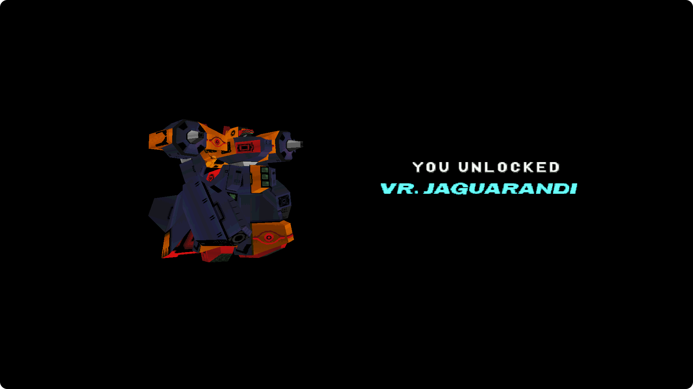
  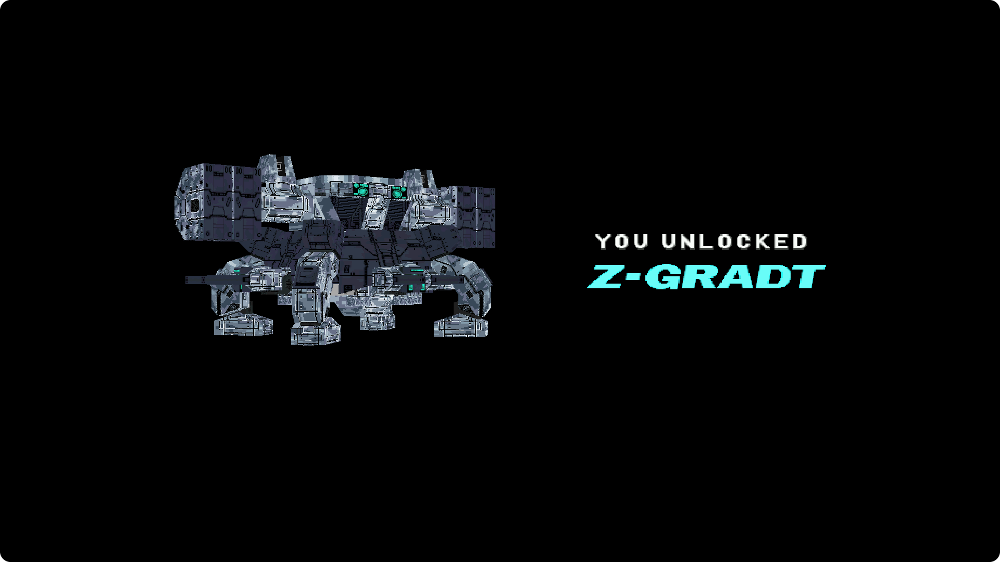
</p>

### What changes

- **Machine select** - an unlocked boss stands in the row after Raiden
  with its own portrait. The row moves left to make room, and the countdown
  runs 20 seconds longer. The Quick VR Select has them too. With Machine
  Color Select on, a boss can wear any of the eight's colours.
- **In a match** - each boss fights with its own weapons. The HUD names
  Jaguarandi's as the Sega Ages release does. Z-Gradt fires its super
  laser with Dash and has a fourth gauge for it under the other three.
  Z-Gradt cannot jump, so the jump button turns it to face the opponent
  instead. The chase camera, the KO replay and the win shots stand further
  back to fit them.
- **Elsewhere** - the Player Data Report shows the boss itself, the ending
  plays with it, and the scoreboard spells both names correctly.

<p align="center">
  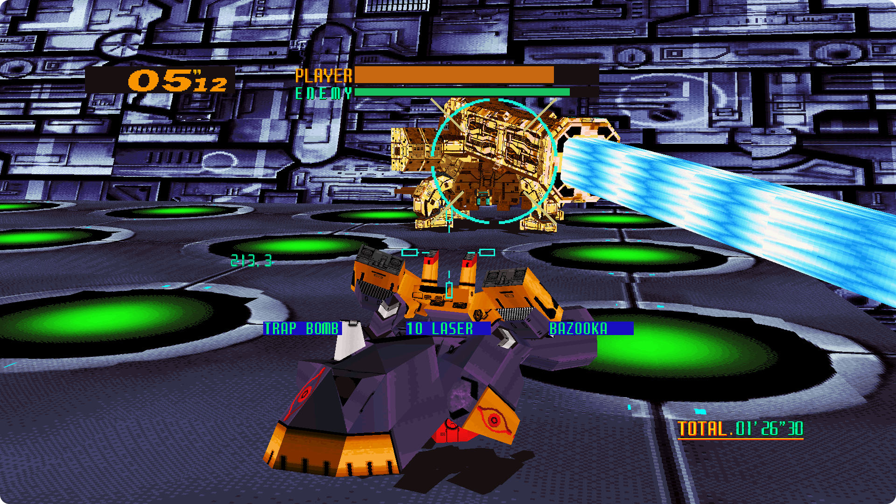
  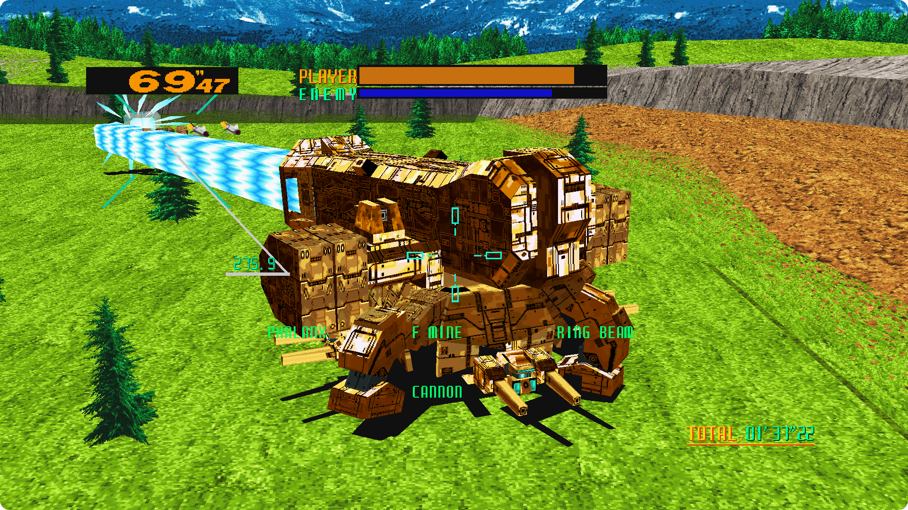
</p>

### Works with everything else

It works with every other patch, on all four [builds](#builds), and with
cnc-ddraw. It is one player only, on purpose: the bosses are far stronger
than the eight, so two-player and internet play keep the select to the
eight. [BOSSES.md](docs/BOSSES.md) has the full account.

## Gamepad

**XInput gamepad support** rebuilds the F7 device list. The legacy joystick
profiles are hidden and four remain, available to both players.

Players on a pad profile take the connected pads in order, 1P first. With
two pads, the first drives 1P and the second 2P. With one pad and 1P on the
keyboard, that pad drives 2P.

<p align="center">
  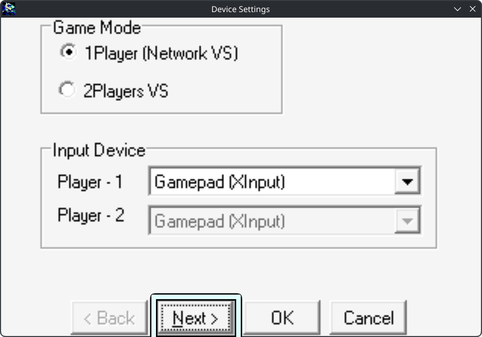
  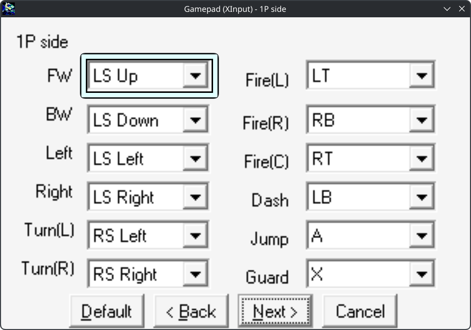
</p>

| Profile | What it is |
| --- | --- |
| **Gamepad (XInput)** | twelve named actions, bound from the F7 screen |
| **Twin-stick (XInput)** | the arcade levers, nothing to bind |
| **Keyboard (Simple)** | every action on a bindable key |
| **Keyboard (Real)** | the game's own two-lever keyboard scheme, bindable |

### Buttons that work everywhere

Four buttons do the same thing on every profile:

| Button | Does |
| --- | --- |
| **A** | Accept - confirms menus, and skips the win and lose screens |
| **Select** | Camera, and skips those screens too |
| **Start** | Pause |
| **D-pad** | Moves, so it also drives the menus |

**A** also skips the intro movie, the same as Space. The D-pad is not
bindable: it always moves, which is what the menus read.

<p align="center">
  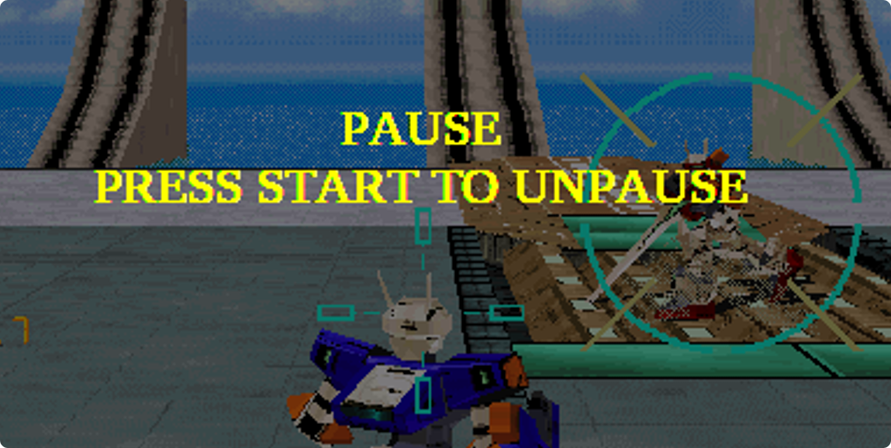
  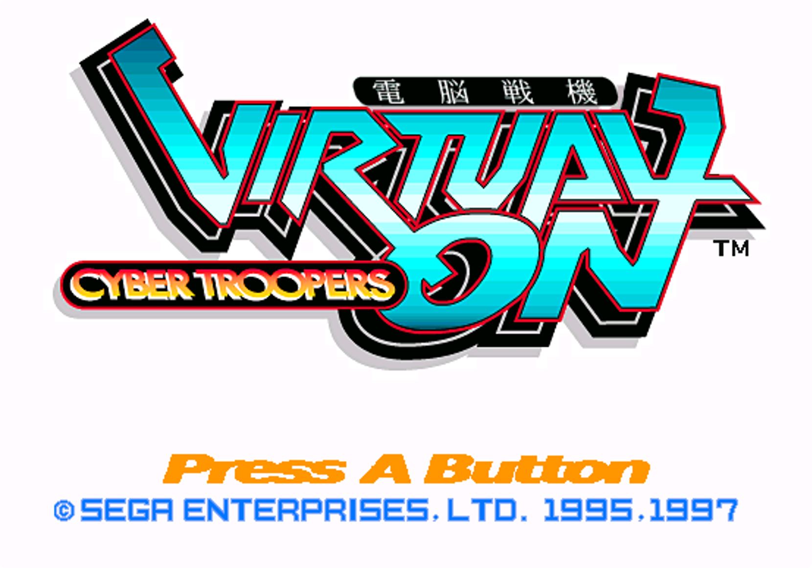
</p>

The on-screen prompts follow the pad: the pause screen reads **PRESS START
TO UNPAUSE**, and the title and scoreboard screens read **Press A Button**.

Applying the patch moves `v_on.ini` aside, because binds saved by the
unpatched game do not fit the new device list. See
[What gets written](#what-gets-written).

### Gamepad (XInput)

Sticks, triggers, bumpers and face buttons are all in the bind list, and the
sticks are read as eight directions.

Defaults for both players: left stick moves, right stick turns, LT and RB
fire left and right, RT fires both, LB dashes, A jumps, X guards.
**Default** on the F7 page puts them back.

**Soft reset:** hold **LB + RB + LT + RT + Start** together and the game
returns to the title screen from wherever it is, on either player's pad.
Like the F keys, it does nothing during an internet match.

### Twin-stick (XInput)

Each thumbstick *is* a lever, the way the cabinet worked, so nothing is
bindable.

| Input | Does |
| --- | --- |
| Both sticks the same way | walk, strafe |
| Left down + right up, or the reverse | turn |
| Sticks apart | jump, and auto-face the opponent |
| Sticks together | crouch, which is the guard |
| **LT**, **RT** | left and right weapon; both at once is the centre weapon |
| **LB**, **RB** | the turbo buttons - dash in the direction you are moving |

### Keyboard (Simple)

The game's original all-keys profile. It shares the bind page with the
gamepad, but each sees only its own inputs and keeps its own saved set in
`v_on.ini`, so switching between them costs nothing.

### Keyboard (Real)

Keeps its own bind page. Two keyboard players cannot share a key: if 2P
wants one 1P already has, rebind 1P first. If 1P is on a pad, 2P can take
1P's keys. **Default** resets whichever side you are editing.

### Stick deadzone

<p align="center">
  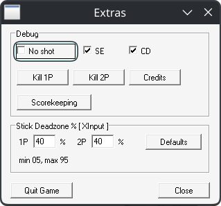
</p>

How far a stick has to move before it counts. It is 40% out of the box, set
per player in the *Stick Deadzone % [ XInput ]* box of the F11 Extras dialog
(with **Disable menu bar** on). That box's **Defaults** button puts both
back to 40.

Closing the dialog saves each to its own `v_on.ini` line, which you can
also edit by hand:

```ini
1P Deadzone=25
2P Deadzone=40
```

Two digits, `05` to `95`. Lower is more sensitive; higher rides out a worn
stick's drift.

## Internet play

Link mode is two-player versus over a network, but stock it never leaves
the LAN, hence the usual advice to run a VPN. **Internet play**, under
ADD-ONS, replaces that layer with plain UDP. One player hosts and gets a
short code, the other types it in. No port forwarding, no VPN. Direct IP is
still there for LAN play.

<p align="center">
  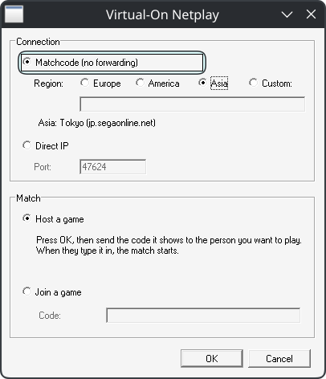
</p>

### Before you start

- **Both players install the add-on.** Select `v_on.exe`, open **ADD-ONS**
  and press **Install** on the *Internet play* row. Nothing downloads; the
  DLL is inside the patcher. If the row says an older netplay DLL is
  installed, press **Install** to update it. **Remove** puts the stock file
  back and you are on LAN-and-VPN play again.

  Or from a terminal:

    ```bash
    python3 v-on-patcher.py --netplay path/to/game            # install
    python3 v-on-patcher.py --netplay path/to/game --remove   # put the stock one back
    ```

- **Both players need Fix frame rate and Fix crash on round loss.** Both
  are Essential, so a game patched with this release always has them; a
  copy from an older patcher may not. A mismatch is refused with a note
  saying so. Nothing else has to match.

### Playing with a code

This is the default, and nobody forwards anything.

1. **Host:** leave the connection on **Matchcode** and pick the **Region**
   nearest to you. Choose **Host a game** and press **OK**.
2. The dialog shows a code like `EU-ABCDE`, with a **Copy** button. Send it
   to the other player.
3. **Guest:** choose **Join a game**, type or paste the code in, and press
   **OK**.

The letters in front say which server the code lives on, so the code is all
the guest needs. Hyphens, spaces and case do not matter. The two machines
talk directly where the routers allow it and through the server where they
do not, so it works from anywhere with UDP.

| Region | Code | Server | Where |
| --- | --- | --- | --- |
| **Europe** | `EU-` | `segaonline.net` | Helsinki |
| **America** | `US-` | `us.segaonline.net` | New York |
| **Asia** | `JP-` | `jp.segaonline.net` | Tokyo |

All three listen on UDP 47625. **Custom** points both players at a server
that is not one of ours; its codes read `XX-ABCDE`.

The guest keeps trying until you cancel, so there is no rush to press things
at the same moment. Once a match is running, a player who quits or crashes
is noticed within a few seconds.

### Playing by IP

For a LAN, or when you would rather not depend on the server. The host
forwards **UDP 47624**, picks *Host a game* and reads out their address;
the dialog shows the local one and looks up the public one on request. The
guest types it in and needs nothing forwarded.

### If a match freezes or plays badly

Force the relay: the match then goes through the server instead of
connecting directly, which is often steadier over a long distance. Open
`vo-net.ini` beside `v_on.exe`, creating it if it is not there, and add
`relay=1` under `[net]`:

```ini
[net]
relay=1
```

One side setting it is enough. Take the line out again for a nearby
opponent, since direct is faster when it works. Matchcode games only.

### If it will not connect at all

Create an empty file called `vo-net.log` beside `v_on.exe` and try again.
The DLL writes what it did into that file, and it is what to send with a
bug report.

## Music

The BGM is CD audio, so unpatched the game needs a disc or a virtual drive
with the audio tracks; a data-only ISO plays nothing. **No disc required**
reads the music from WAV files beside the game instead.

### Ripping the tracks

Use the same **Source** box as the install: one cue sheet holds the game
and the soundtrack both. Press **Rip soundtrack**; the note under the
buttons names the folder they go to. On Linux a drive works in **Source**
too, a cdemu one like a physical drive. Windows drives are not read; image
the disc first, as in
[If you have the disc, not an image](#if-you-have-the-disc-not-an-image).

Or from a terminal:

```bash
python3 v-on-patcher.py --rip VIRTUAL-ON.cue /path/to/VIRTUAL-ON
python3 v-on-patcher.py --rip /dev/sr0       /path/to/VIRTUAL-ON   # Linux
python3 v-on-patcher.py --rip                # list drives (Linux)
```

The directory is the one holding `v_on.exe`; `music\` is created inside it.
About 320 MB: 26 tracks, roughly 30 minutes, uncompressed.

```
VIRTUAL-ON\
    v_on.exe
    music\
        track02.wav ... track27.wav
```

Track 1 is the data track and has no file. The numbering must match the
disc, because the game asks for tracks by number.

### At runtime

With **No disc required** unticked the folder is ignored. With it on and
`music\` missing or empty, the game reads the drive as before; with tracks
there, they are used, disc or no disc. Under Wine they play without any
`dosdevices` entry, raw device link or cdemu instance.

## Windowing and scaling (cnc-ddraw)

The game asks for exclusive fullscreen at its render size and leaves the
rest to the display. On a modern panel that can mean a stretched picture or
no windowed mode. [cnc-ddraw](https://github.com/FunkyFr3sh/cnc-ddraw)
replaces the DirectDraw the game renders through, adding windowed and
borderless modes, correct aspect ratio and upscaling. Every patch here works
with it.

<p align="center">
  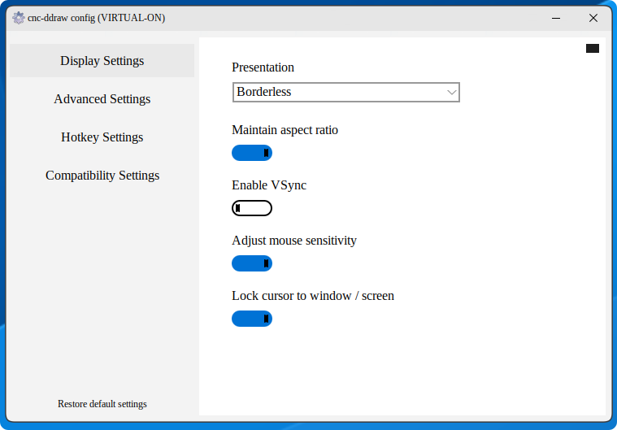
</p>

### Installing

**Install** under ADD-ONS downloads the current release from
[its releases page](https://github.com/FunkyFr3sh/cnc-ddraw/releases) and
unpacks it beside `v_on.exe`: `ddraw.dll`, `ddraw.ini`, `cnc-ddraw
config.exe` and the shaders. The same button then reads **Remove**, which
deletes the files again but keeps `ddraw.ini`, so re-running to update
leaves your settings alone. Close the game first: Windows will not replace a
DLL that is loaded. From a terminal:

```bash
python3 v-on-patcher.py --ddraw path/to/game
```

**On Linux there is a second step.** Set `ddraw` to native in `winecfg` for
that prefix, or run `cnc-ddraw config.exe` once. Without it Wine keeps using
its own DirectDraw and nothing changes.

### The settings it ships with

A fresh `ddraw.ini` is cnc-ddraw's own file with `fullscreen`, `windowed`,
`maintas`, `noactivateapp`, `toggle_borderless`, `devmode` and
`game_handles_close` set to `true`. That gives a borderless window at the
right aspect ratio that does not trap the cursor. Change any of it with
`cnc-ddraw config.exe`.

`game_handles_close` is the one that is not about the picture: without it,
closing the window loses your settings and records for that session. If you
already have a `ddraw.ini`, add the line by hand:

```ini
[ddraw]
game_handles_close=true
```

The intro movie does not go through DirectDraw, so upscaling leaves it small
and in the corner. **Intro, loading and ending screens** under Extra fits it
to the window; without that, skip it with Space, Enter, Escape or pad A.

### gamescope

gamescope handles the scaling without a DLL, if you would rather:

```bash
gamescope -W 1920 -H 1080 -w 640 -h 480 -f -S integer -- %command%
```

`-S fit` fills more of the screen without whole-number scaling.

## Builds

Four builds of the game exist, and every patch works on all four. The
window names the build it is looking at.

| Build | Size | MD5 |
| --- | --- | --- |
| English retail | 6,650,880 | `a464b0ff32d5bab499f265e45658504e` |
| USA OEM | 6,649,344 | `4c70f780a7f0d98d74be62304fb99021` |
| Japanese rerelease | 6,621,696 | `d19320bdc3381a48228990907910a391` |
| Japanese original | 6,644,224 | `9764d946ffc8cee94788707c91753478` |

The USA, USA Alt and European discs all carry the same English retail
`v_on.exe`, so any of them will do.
**[The Japanese original](https://redump.info/disc/133978)** is the 1997
1.04J pressing, also found in the Sega PC Greatest Hits Vol. 3 bundle. It
has had the least play.

A repack, a bad rip or a copy already modified is refused, with its size
and MD5 shown beside a supported build's. Installing and ripping work
whichever build the disc holds; only patching needs one from the table.

### What gets written

The original is copied to `v_on.exe.bak` first, and nothing is written
unless every selected patch applied, so a failure leaves the game as it was.

**XInput gamepad support** touches two more files. `v_on.ini` is moved to
`v_on.ini.bak` and the game writes a fresh one, because binds saved by the
unpatched game do not fit the new device list. The title artwork,
`escrgame.bin` or `jscrgame.bin` on the Japanese builds, is rewritten
with the new title prompt after a copy is kept as `.bak`. **Playable
bosses** writes the bosses' portraits into the same artwork file, backed up
the same way. **Version and credit in the game** backs up and rewrites the
two credit roll files. **Pre-unlock the bosses** writes `bosses.bin` beside
the game, which **Restore original** leaves alone.

**Restore original** puts every backed-up file back, keeping whatever the
patched game wrote as `v_on.ini.patched`. Use it rather than copying a
`.bak` over by hand: the artwork and `v_on.exe` have to match, and
restoring one alone draws the title prompt as scrambled letters.

## Running the Python script

The patcher is one Python script, `v-on-patcher.py`; the Windows download
is that script with Python beside it. On Linux, or if you would rather not
run the exe, run the script itself. `v-on-patcher-*-python.zip` from the
[latest release](https://github.com/pairomaniac/v-on-patcher/releases/latest)
is the script with the netplay DLL beside it in `net/`, nothing else. A
checkout of this repository has the same two files in the same places.

Windows, with Python from python.org, which ships Tk:

```
py v-on-patcher.py
```

On Linux, Tk usually needs installing:

```bash
sudo apt install python3-tk        # Debian, Ubuntu, Mint
sudo dnf install python3-tkinter   # Fedora, RHEL
sudo pacman -S tk                  # Arch, EndeavourOS
python3 v-on-patcher.py
```

Everything the patcher does is also available without a window:

```bash
python3 v-on-patcher.py --install CUE DIR  # the game, out of a disc image
python3 v-on-patcher.py --rip SOURCE DIR   # soundtrack, from a cue sheet or drive
python3 v-on-patcher.py --ddraw DIR        # fetch and install cnc-ddraw
python3 v-on-patcher.py --netplay DIR      # install the UDP netplay DLL
python3 v-on-patcher.py --selfcheck        # validate the patch tables
```

## Working on the patcher

[docs/README.md](docs/README.md) maps the developer documentation:
[DEVELOPING.md](docs/DEVELOPING.md) for the checks, the release and the
Windows build, [NOTES.md](docs/NOTES.md) for what each patch does inside the
game, and [asm/](asm/) for the machine code the patches install.

## AI disclaimer

LLMs are part of the toolchain here: much of the assembly and the
documentation was written with one. The reverse engineering was not. The
addresses and the behaviour each patch relies on come from tracing and
debugging the running game with Ghidra, gdb, winedbg, Cheat Engine and
Unicorn, and the LLM writes to that brief. The scope, the disc dumps, the
testing and the debugging are human. The patcher edits the game's own
files and adds its code beside them; it is not a reimplementation of the
game.

Every change is read line by line before it goes in, and every patch is
played on all four builds before it ships. Offsets and bytes are verified
against the originals before anything is written, and the patcher refuses
any file that is not an unmodified build it has tables for. It is still a
hobby project poking at a nearly 30-year-old binary, so expect bugs.

## Credits and licence

Some of the byte edits come from the original VO_Patch 0.43 (2008) by
[UE2A-GEL](https://jaguarandi.xxxxxxxx.jp/). Rights to the game belong to
SEGA. `LICENSE` (MIT) covers the patcher, its tools and its documentation -
not the game, not the bytes quoted from it, and not the letterforms traced
from its artwork.

The logo and icon are the work of SirRockEmSockEm, who also took the
in-game shots above. **Playable bosses** - the two bosses as player
machines, their select, unlock and portraits - is the work of
[Vortyne](https://github.com/Vortyne).

Bug reports and patches are welcome as issues and pull requests. For
anything else - a disc image of a build the patcher does not know, or a
question that does not fit an issue - write to pairo@segaonline.net.
